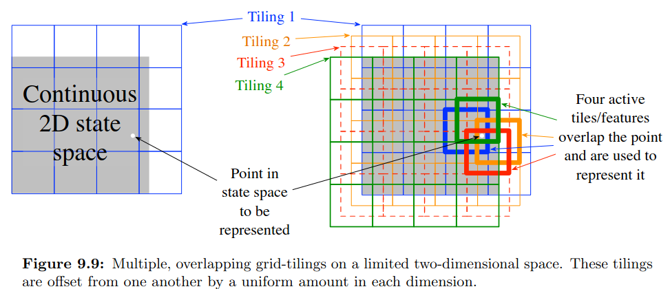
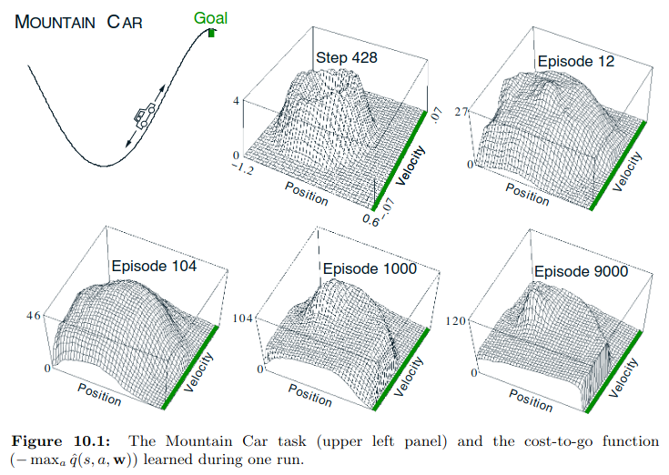
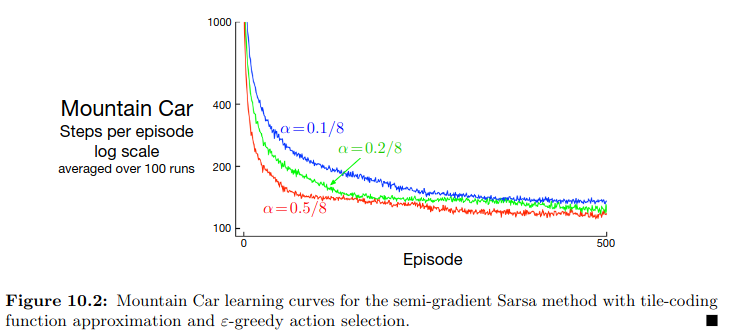
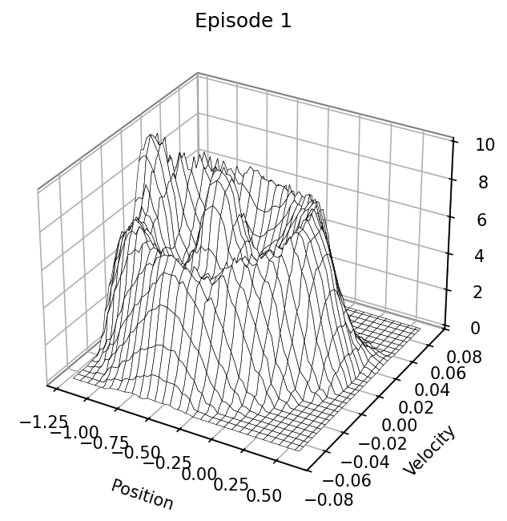
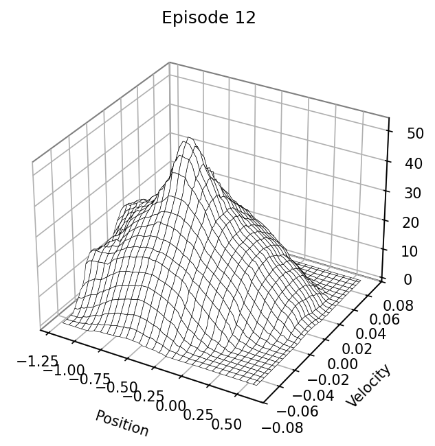
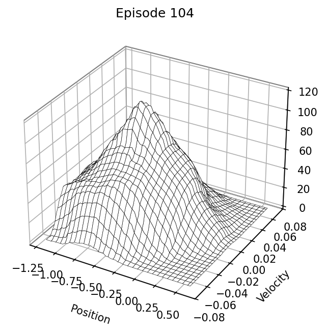
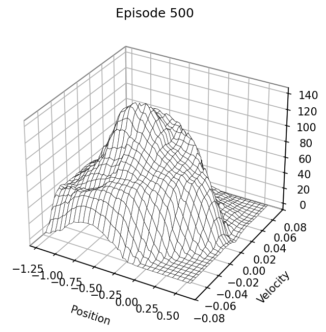
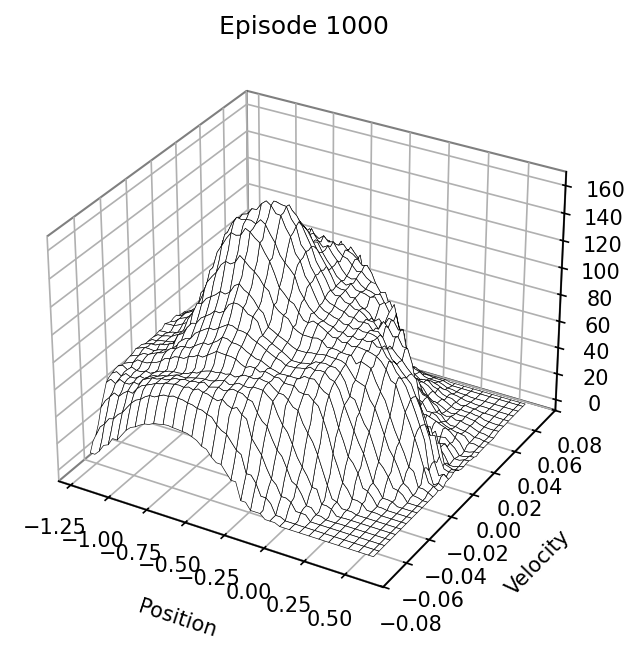
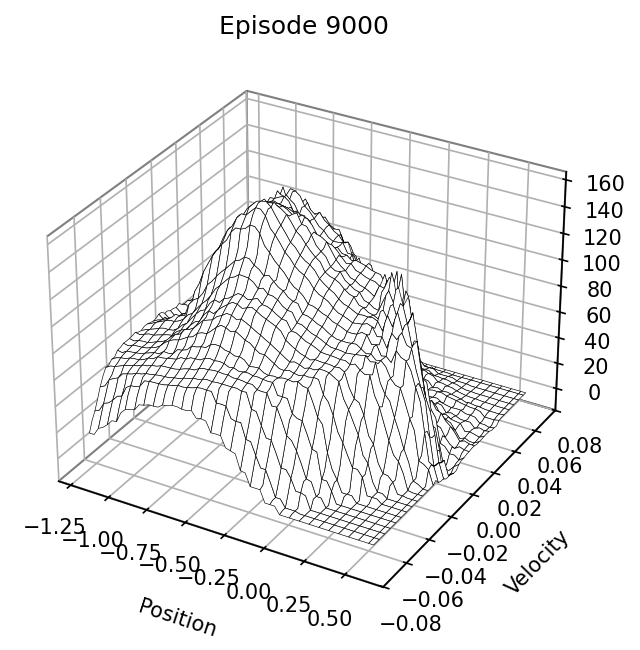

# Sarsa semi-gradiente com Tile-coding

Autoria: João Arthur Gaia da Rocha Almeida · 2026.2 · PPGI071 Aprendizado por Reforço (UFAL)

Referência: Sutton & Barto (2020), § 10.1 / Lapan (2024), cap. Z

## Motivação

Imagine o cenário em que se tem um espaço de estados contínuo, como por exemplo a velocidade e posição de um carro.
Ou ainda que o espaço de estados seja discreto, mas com uma alta dimensionalidade, como por exemplo o gerenciamento
de um computador, onde voga o estado de cada núcleo do processador, da RAM, do cache, consumo energético, entradas e saídas,
gerenciamento de arquivos...

Representar esses cenários é computacionalmente custoso, principalmente para métodos tabulares tradicionais, como ação valor,
bandit e implementações incrementais. Uma alternativa viável é SARSA semi-gradient com tile-coding.

Para fins didáticos, utilizarei o acrônimo SARSA-SG-TC para me referir ao algoritmo, ressalto que nenhuma das referências utilizadas
usa esse termo.

## Onde isto se encaixa

### Classificação

Justamente por não ser um algoritmo tabular, o SARSA-SG-TC se sai bem nesses ambientes contínuos ou complexos. Ele faz isso pois
mapeia sua política com uma função e não com uma tabela, o que o classifica como uma estratégia de aproximação.

E, por não agir diretamente no ambiente, e não em um modelo, o SARSA-SG-TC é model-free.

Também trata-se de um método on-policy, visto que o aprendizado dele se dá direto com o resultado das ações no ambiente. Sem nenhum tipo de política prévia.

Por fim, como a política só é avaliada ao final de cada episódio, e não ao final de cada passo no espaço de estados, trata-se de um algoritmo episódico.

<genealogia: de qual método da disciplina descende e o que muda na atualização>

### Tabela de símbolos

| Símbolo | Nome | O que é |
|---|---|---|
| $t$ | passo de tempo | o tempo é discreto: $t = 0, 1, 2, \dots$ |
| $S_t \in \mathcal{S}$ | estado  | o que o agente sabe no instante $t$ |
| $A_t \in \mathcal{A}(s)$ | ação  | a única coisa que o agente controla |
| $R_{t+1} \in \mathbb{R}$ | recompensa  | avaliação imediata, escalar |
| $\mathbf{w}_t$ | pesos | vetor de pesos que atualiza a aproximação |
| $a$ | ação | ação disponível em $S_t$
| $q_\pi(S_t,A_t)$ | valor da ação | retorno esperado fixando a primeira ação |
| $\hat{q}(S_t,a,\mathbf{w}_t)$ | valor da ação aproximado | aproximação de retorno esperado |
| $G_t$ | retorno | soma descontada das recompensas futuras |
| $U_t$ | atualização de alvo | Qualquer aproximação de $q_\pi(S_t,A_t)$, incluindo qualquer dos retornos de SARSA n-step ou $G_t$ |
| $\alpha$ | tamanho do passo | é um ganho positivo, o quanto algoritmo "anda" |
| $\epsilon$ | avaliação de politica | é a estratégia de melhoramento de política, por exemplo, $\epsilon$-greedy |
| $A^*_t$ | ação greedy | é a ação mais vantajosa naquele momento |

<hipóteses: o que o método assume e o que quebra quando a hipótese cai>

## A ideia
Dado que estamos trabalhando em um ambiente contínuo ou complexo, mesmo que discreto, é difícil saber qual o valor de um estado, dado uma política. Então a ideia é usar uma aproximação desse estado e minimizar o erro dessa aproximação perante o valor real. isto é feito da seguinte forma:

Para cada episódio, começa-se com um par estado e ação inicial. Para cada passo dentro desse episódio, toma-se a ação inicial, observa-se o novo estado e a recompensa. Caso o estado seja terminal, a aproximação é atualizada seguindo o gradiente descendente e iterasse para o próximo episódio. Caso contrário, a aproximação é atualizada com o "episodic semi-gradient one-step Sarsa", toma-se uma nova ação e o ciclo continua.

Em espaços contínuos, costumeiramente bidimensionais, a técnica de tilecoding surge como a discretização desse espaço, onde vários grids deslocados são postos sobre um mesmo espaço, o que dá um número maior de features pra um mesmo ponto. Isso fica mais claro com a Figura 9.9 do livro do Sutton & Barto:

Que, em geral, faz com que a discretização represente mais fielmente o valor contínuo, que por sua vez faz com que os algoritmos convirjam mais rápido usando essa abordagem, como mostra a figura 9.10 do livro do Sutton & Barto:

A junção dessas duas abordagens, compõem o SARSA-SG-TC.
## Formalização

Primeiramente, precisamos considerar que estamos trabalhando com uma aproximação $\hat{q}$, isto é, $\hat{q} \approx q_\pi$. que é parametrizada de forma funcional com um vetor de pesos $\mathbf{w}$. Ou seja, para computar $\hat{q}$, precisamos de $\mathbf{w}$ atualizado.

E esse é o grande ponto do SARSA-SG-TC, a atualização de $\mathbf{w}$. Isso é feito de duas maneiras distintas. A primeira é mais direta, é o caso geral da atualização de função ação-valor por gradiente descendente:

$\mathbf{w}_{t+1} \doteq \mathbf{w}_t + \alpha \left[ U_t - \hat{q}(S_t, A_t, \mathbf{w}_t) \right] \nabla \hat{q}(S_t, A_t, \mathbf{w}_t)$

Esse caso é usado quando chegamos a um conjunto de ações pequeno, na prática, quando um estado é terminal. Contudo, na maior parte do tempo, a atualização de $\mathbf{w}$ é dada por:

$\mathbf{w}_{t+1} \doteq \mathbf{w}_t + \alpha \left[ R_{t+1} + \gamma \hat{q}(S_{t+1}, A_{t+1}, \mathbf{w}_t) - \hat{q}(S_t, A_t, \mathbf{w}_t) \right] \nabla \hat{q}(S_t, A_t, \mathbf{w}_t)$

Que é o famoso semi-gradiente, "episodic semi-gradient one-step Sarsa", e opera bem em conjuntos grandes de ações, contínuos, que exigem pesquisa e que ainda não têm uma resolução clara.

Com isso, para cada ação $a$ disponível para o estado atual, $S_t$, é possível computar $\hat{q}(S_t, a, \mathbf{w}_t)$ e encontrar a "greedy action", que é dada por:

$A_t^* = \arg\max_a \hat{q}(S_t, a, \mathbf{w}_t)$

Que pode ser computada de diferentes formas, comumente $\epsilon$-greedy, e as açoẽs serão selecionadas dessa maneira.

Note também, que os estados são representados por vetores de features $\mathbf{x}(s,a)$. Essa abordagem implica em uma alteração na aproximação $\hat{q}$, que agora deve considerar $\mathbf{x}$:

$\hat{q}(s, a, \mathbf{w}) \doteq \mathbf{w}^\top \mathbf{x}(s, a) = \sum_{i=1}^d w_i \cdot x_i(s, a)$

## Pseudocódigo

| Pseudocódigo | 
|---|
| Entrada: Parametrização diferenciável de função -- valores $\hat{q} : \mathcal{S} \times \mathcal{A} \times \mathbb{R}^d \to \mathbb{R}$ | 
| Parâmetro do algoritmo: Tamanho do passo $\alpha>0$ e um pequeno $\epsilon > 0$ |
| Inicialize os pesos da função-valor $\mathbf{w} \in \mathbb{R}^d $ |
| Loop para cada episódio: |
| &nbsp;&nbsp; $S, A \gets$ Estado inicial e ação do episódio (por exemplo, $\epsilon$-greedy) |
| &nbsp;&nbsp;Loop para cada passo do episódio: |
| &nbsp;&nbsp;&nbsp;&nbsp;Tome a ação $A$, observe $R, S'$ |
| &nbsp;&nbsp;&nbsp;&nbsp;Se $S'$  for terminal: |
| &nbsp;&nbsp;&nbsp;&nbsp;&nbsp;&nbsp; $\mathbf{w} \leftarrow \mathbf{w} + \alpha [R - \hat{q}(S, A, \mathbf{w})] \nabla \hat{q}(S, A, \mathbf{w})$ |
| &nbsp;&nbsp;&nbsp;&nbsp;&nbsp;&nbsp;Vá para o próximo episódio |
| &nbsp;&nbsp;Escolha $A'$  Como uma função de $\hat{q}(S, ., \mathbf{w})$  (por exemplo, $\epsilon$-greedy) |
| &nbsp;&nbsp; $\mathbf{w} \leftarrow \mathbf{w} + \alpha \left[ R + \gamma \hat{q}(S', A', \mathbf{w}) - \hat{q}(S, A, \mathbf{w}) \right] \nabla \hat{q}(S, A, \mathbf{w})$ |
| &nbsp;&nbsp; $S \gets S'$ |
| &nbsp;&nbsp; $A\gets A'$ |

## Implementação

O projeto está dividido em quatro arquivos: [main.py](scripts/main.py), [semi_gradient_sarsa.py](scripts/semi_gradient_sarsa.py), [tile_coding.py](scripts/tile_coding.py), e [train.py](scripts/train.py). Cada um deles está descrito abaixo:

* [main.py](scripts/main.py) É onde ocorre de fato a execução do algoritmo, já treinado. Para isso, carrega-se os aqruivos .pkl ([tilings.pkl](scripts/tilings.pkl) e [weights.pkl](scripts/weights.pkl)), que contém o resultado do treinamento. A cada iteração do loop uma nova ação é ecolhida, seu resultado é atualizado no ambiente, que pode ser visualizado por uma janela do pygame.

* [semi_gradient_sarsa.py](scripts/semi_gradient_sarsa.py), Aqui é onde há de fato a implementação do SARSA-SG-TC. Primeiramente há uma classe com todos os parâmetros necessários ao algoritmo. A função "update_weight", faz a jogada entre o gradiente descendente e o semi gradiente, que foi comentada na [formalização](#formalização). A função "train" implementa a lógica apresentada no [pseudocódigo](#pseudocódigo), há um detalhe na decisão que considera se o estado é terminal, para a geração de figuras, tbm se considerou um limite de passos. Existe uma subrotina "plot_cost_to_go" que é usada para gerar as figuras de "cost-to-go" que serão explicadas na seção de [Experimento](#experimento) e também há uma chamada de "save_params", que persiste o resultado do treinamento nos aqruivos .pkl ([tilings.pkl](scripts/tilings.pkl) e [weights.pkl](scripts/weights.pkl)) . A função "select_action", implementa a questão de decidir qual a melhor ação disponível, , que foi comentada na [formalização], é usada tanto para o treinamento, quanto para a execução. As demais funções são auxiliares, tratam da manipulação de vetores, dicionários e do tile coding.

* [tile_coding.py](scripts/tile_coding.py) é uma biblioteca escrita por Sutton e Barto, sem nenhuma modificação, que implementa toda a lógica de tile coding. Nesse projeto é uma abstração para a implementação do SARSA-SG-TC.

* [train.py](scripts/train.py) é uma abstração de [semi_gradient_sarsa.py](scripts/semi_gradient_sarsa.py), a função "train" é um atalho para sua homônima, já explicada, porém inclui uma subrotina que é pré-requisito pra execução dela. Além de duas funções que são usadas para gerar a figura de curva de aprendizado, que será explicada na seção de [Experimento](#experimento).

## Experimento: 

A ideia é reproduzir o cenário "Mountain Car", que trata do desafio de subir uma ladeira muito íngrime com um carro muito fraco. Se tentar só acelerar, o carro morre na metade, é preciso voltar e pegar "embalo". Repete-se esse processo até que é possível chegar ao cume da montanha. Esse cenário pode ser visto no canto superior esquerdo da figura 10.1 de Sutton e Barto:

Nesse cenário há 3 possíveis ações, acelerar para frente, com recompensa +1, acelerar para trás, com recompensa -1, e não acelerar, com recompensa 0.

A física do problema é regida por uma equação de posição e outra de velocidade, porém isso é embutido no ambiente do gymnasium, não entrarei em detalhes nesse texto.

As outras subfiguras mostram a evolução do treinamento, com o passar dos episódios. A faixa verde no canto direito é o objetivo, a posição 0.6 significa que subimos a ladeira, independente de velocidade. A altura da superfície aponta o quão difícil é chegar no objetivo a partir daquele estado.

Note que a altura das figuras aumenta com o passar do tempo, isso significa que o sistema entendeu melhor o ambiente e sabe a real dificuldade de sair de um vale com baixa velocidade, por exemplo.

Também é notável que o "relevo" vai ficando mais bem definido com o passar do tempo, mostrando que o sistema realmente "aprendeu". Se tentar só subir a ladeira aumentando a velocidade, o custo aumenta. Se ganhar velocidade negativa, o custo diminui, adquire-se o "embalo" e fica mais fácil chegar no objetivo.

Outra questão interessante é saber o quanto o tamanho do passo influi na convergência do algoritmo, como mostra a figura 10.2 de Sutton e Barto:

Nosso objetivo é reproduzir as duas figuras apresentadas.

A primeira é mais difícil de entender, porém é mais fácil de obter. Para tal, basta executar a função train com a flag generate_figs ligada. Quando chega-se a um final de episódio e é um dos episódios a ter a figura gerada, os dados do episódio geram uma meshgrid, que formarão as figuras a seguir:
|   |   |   |
|---|---|---|
|   |   |   |

Que seguem comportamento muito similar ao apresentado por Sutton e Barto, inicia de maneira exploratória, com movimento circular no espaço, em torno do estado original. Em seguida o ambiente é melhor conhecido, percebe-se que ficar no fundo do vale com a velocidade nula é um péssimo negócio, representado pelo pico. Também nota-se que a redução da velocidade, diminui o custo, então pegar embalo torna-se vantajoso. E, por fim, quando se está perto do objetivo, basta um pequeno esforço para o custo diminuir abruptamente. Todo esse comportamento, comprova que o agente de fato aprendeu.

Já a segunda figura é simples de compreender e custosa de obter. Pois exige a repetição do treinamento por 300 veze, 100 vezes para cada valor de $\alpha$

## Limites

<onde falha; qual método resolve isso>

## Referências

* Sutton, R. S., & Barto, A. G. (2018). *Reinforcement Learning: An Introduction* (2nd ed.). Bradford Books. Cap. 9, 10. Sec. 9.5.4, 10.1.
* Jabrah Tutorials (2023). Reinforcement Learning. mountain_car. [github.com/JabrahTutorials/ReinforcementLearning.git](https://github.com/JabrahTutorials/ReinforcementLearning.git) , [www.youtube.com/watch?v=Lphlyuvocz0](https://www.youtube.com/watch?v=Lphlyuvocz0)
* O'neill, M. (2018). Reinforcement Learning Tutorial: Semi-gradient n-step Sarsa and Sarsa(λ) Theory and Implementation. [michaeloneill.github.io/RL-tutorial.html](https://michaeloneill.github.io/RL-tutorial.html)

A principal referência foi Sutton & Barto, que também é referência para as demais, a base teórica e figuras a serem reproduzidas foram tiradas dessa fonte. A biblioteca de tile coding é a mesma desenvolvida por Sutton.

Jabrah Tutorials tem uma aula muito boa sobre o assunto e foi a principal referência em código. Contudo, algumas mudanças significativas foram feitas, principalmente para o ajuste do tile coding e geração de figuras.

O'Neill tem uma forma muito didática de explicar, além de fazer muitas comparações com métodos mais tradicionais. Também possui uma implementação do problema, que considerei mais complexa que a de Jabrah. Porém, sua visualização da figura cost to go, foi útil para a criação das figuras desse trabalho.

