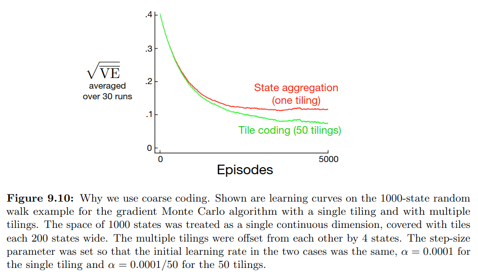

# Sarsa semi-gradiente com Tile-coding

Autoria: João Arthur Gaia da Rocha Almeida · 2026.2 · PPGI071 Aprendizado por Reforço (UFAL)

Referência: Sutton & Barto (2020), § 10.1 / Lapan (2024), cap. Z

## Motivação

Imagine o cenário em que se tem um espaço de estados contínuo, como por exemplo a velocidade e posição de um carro.
Ou ainda que o espaço de estados seja discreto, mas com uma alta dimensionalidade, como por exemplo o gerenciamento
de um computador, onde voga o estado de cada núcleo do processador, da RAM, do cache, consumo energético, entradas e saídas,
gerenciamento de arquivos...

Representar esses cenários é computacionalmente custoso, principalmente para métodos tabulares tradicionais, como ação valor,
bandit e implementações incrementais. Uma alternativa viável é SARSA semi-gradient com tile-coding.

Para fins didáticos, utilizarei o acrônimo SARSA-SG-TC para me referir ao algoritmo, ressalto que nenhuma das referências utilizadas
usa esse termo.

## Onde isto se encaixa

### Classificação

Justamente por não ser um algoritmo tabular, o SARSA-SG-TC se sai bem nesses ambientes contínuos ou complexos. Ele faz isso pois
mapeia sua política com uma função e não com uma tabela, o que o classifica como uma estratégia de aproximação.

E, por não agir diretamente no ambiente, e não em um modelo, o SARSA-SG-TC é model-free.

Também trata-se de um método on-policy, visto que o aprendizado dele se dá direto com o resultado das ações no ambiente. Sem nenhum tipo de política prévia.

Por fim, como a política só é avaliada ao final de cada episódio, e não ao final de cada passo no espaço de estados, trata-se de um algoritmo episódico.

<genealogia: de qual método da disciplina descende e o que muda na atualização>

### Tabela de símbolos

| Símbolo | Nome | O que é |
|---|---|---|
| $t$ | passo de tempo | o tempo é discreto: $t = 0, 1, 2, \dots$ |
| $S_t \in \mathcal{S}$ | estado  | o que o agente sabe no instante $t$ |
| $A_t \in \mathcal{A}(s)$ | ação  | a única coisa que o agente controla |
| $R_{t+1} \in \mathbb{R}$ | recompensa  | avaliação imediata, escalar |
| $\mathbf{w}_t$ | pesos | vetor de pesos que atualiza a aproximação |
| $a$ | ação | ação disponível em $S_t$
| $q_\pi(S_t,A_t)$ | valor da ação | retorno esperado fixando a primeira ação |
| $\hat{q}(S_t,a,\mathbf{w}_t)$ | valor da ação aproximado | aproximação de retorno esperado |
| $G_t$ | retorno | soma descontada das recompensas futuras |
| $U_t$ | atualização de alvo | Qualquer aproximação de $q_\pi(S_t,A_t)$, incluindo qualquer dos retornos de SARSA n-step ou $G_t$ |
| $\alpha$ | tamanho do passo | é um ganho positivo, o quanto algoritmo "anda" |
| $\epsilon$ | avaliação de politica | é a estratégia de melhoramento de política, por exemplo, $\epsilon$-greedy |
| $A^*_t$ | ação greedy | é a ação mais vantajosa naquele momento |

<hipóteses: o que o método assume e o que quebra quando a hipótese cai>

## A ideia
Dado que estamos trabalhando em um ambiente contínuo ou complexo, mesmo que discreto, é difícil saber qual o valor de um estado, dado uma política. Então a ideia é usar uma aproximação desse estado e minimizar o erro dessa aproximação perante o valor real. isto é feito da seguinte forma:

Para cada episódio, começa-se com um par estado e ação inicial. Para cada passo dentro desse episódio, toma-se a ação inicial, observa-se o novo estado e a recompensa. Caso o estado seja terminal, a aproximação é atualizada seguindo o gradiente descendente e iterasse para o próximo episódio. Caso contrário, a aproximação é atualizada com o "episodic semi-gradient one-step Sarsa", toma-se uma nova ação e o ciclo continua.

Em espaços contínuos, costumeiramente bidimensionais, a técnica de tilecoding surge como a discretização desse espaço, onde vários grids deslocados são postos sobre um mesmo espaço, o que dá um número maior de features pra um mesmo ponto. Isso fica mais claro com a Figura 9.9 do livro do Sutton & Barto:

Que, em geral, faz com que a discretização represente mais fielmente o valor contínuo, que por sua vez faz com que os algoritmos covirjam mais rápido usando essa abordagem, como mostra a figura 9.10do livro do Sutton & Barto:

A junção dessas duas abordagens, compõem o SARSA-SG-TC.
## Formalização

<derivação passo a passo, na notação da disciplina>

## Pseudocódigo

$$
\begin{aligned}
& \texttt{Entrada: Parametrização diferenciável de função a função -- valores }\hat{q} : \mathcal{S} \times \mathcal{A} \times \mathbb{R}^d \to \mathbb{R}\\

& \texttt{Parâmetro do algoritmo: Tamanho do passo }\alpha>0 \texttt{ e um pequeno } \epsilon > 0\\

& \texttt{Inicialize os pesos da função-valor } \mathbf{w} \in \mathbb{R}^d\\

& \texttt{Loop para cada episódio:}\\
& \texttt{  }S, A \gets \texttt{Estado inicial e ação do episódio (por exemplo, } \epsilon \texttt{-greedy)}\\
& \texttt{  Loop para cada passo do episódio:}\\
& \texttt{  }\texttt{    Tome a ação } A \texttt{, observe } R, S'\\
& \texttt{  }\texttt{  Se } S' \texttt{for terminal:}\\
& \texttt{  }\texttt{  }\texttt{  }\mathbf{w} \leftarrow \mathbf{w} + \alpha [R - \hat{q}(S, A, \mathbf{w})] \nabla \hat{q}(S, A, \mathbf{w})\\
& \texttt{  }\texttt{  }\texttt{  Vá para o próximo episódio}\\
& \texttt{  }\texttt{  Escolha } A' \texttt{ Como uma função de }\hat{q}(S, ., \mathbf{w}) \texttt{ (por exemplo, } \epsilon \texttt{-greedy)}\\
& \texttt{  }\texttt{  }\mathbf{w} \leftarrow \mathbf{w} + \alpha \left[ R + \gamma \hat{q}(S', A', \mathbf{w}) - \hat{q}(S, A, \mathbf{w}) \right] \nabla \hat{q}(S, A, \mathbf{w})\\
& \texttt{  }\texttt{  }S \gets S'\\
& \texttt{  }\texttt{  }A \gets A'\\

\end{aligned}
$$
<caixa no estilo do livro>

## Implementação

<as decisões que o pseudocódigo esconde>

## Experimento: 

<figura, o que ela mostra, por que era esse o resultado esperado>

## Limites

<onde falha; qual método resolve isso>

## Referências

* Sutton, R. S., & Barto, A. G. (2018). *Reinforcement Learning: An Introduction* (2nd ed.). Bradford Books. Cap. 9, 10. Sec. 9.5.4, 10.1.
* Jabrah Tutorials (2023). Reinforcement Learning. mountain_car. [github.com/JabrahTutorials/ReinforcementLearning.git](https://github.com/JabrahTutorials/ReinforcementLearning.git) , [www.youtube.com/watch?v=Lphlyuvocz0](https://www.youtube.com/watch?v=Lphlyuvocz0)
* O'neill, M. (2018). Reinforcement Learning Tutorial: Semi-gradient n-step Sarsa and Sarsa(λ) Theory and Implementation. [michaeloneill.github.io/RL-tutorial.html](https://michaeloneill.github.io/RL-tutorial.html)

A principal referência foi Sutton & Barto, que também é referência para as demais, a base teórica e figuras a serem reproduzidas foram tiradas dessa fonte. A biblioteca de tile coding é a mesma desenvolvida por Sutton.

Jabrah Tutorials tem uma aula muito boa sobre o assunto e foi a principal referência em código. Contudo, algumas mudanças significativas foram feitas, principalmente para o ajuste do tile coding e geração de figuras.

O'Neill tem uma forma muito didática de explicar, além de fazer muitas comparações com métodos mais tradicionais. Também possui uma implementação do problema, que considerei mais complexa que a de Jabrah. Porém, sua visualização da figura cost to go, foi útil para a criação das figuras desse trabalho.

<bibliografia com capítulo e seção; artigos; implementações consultadas>
<divergências entre fontes e qual versão foi seguida>
